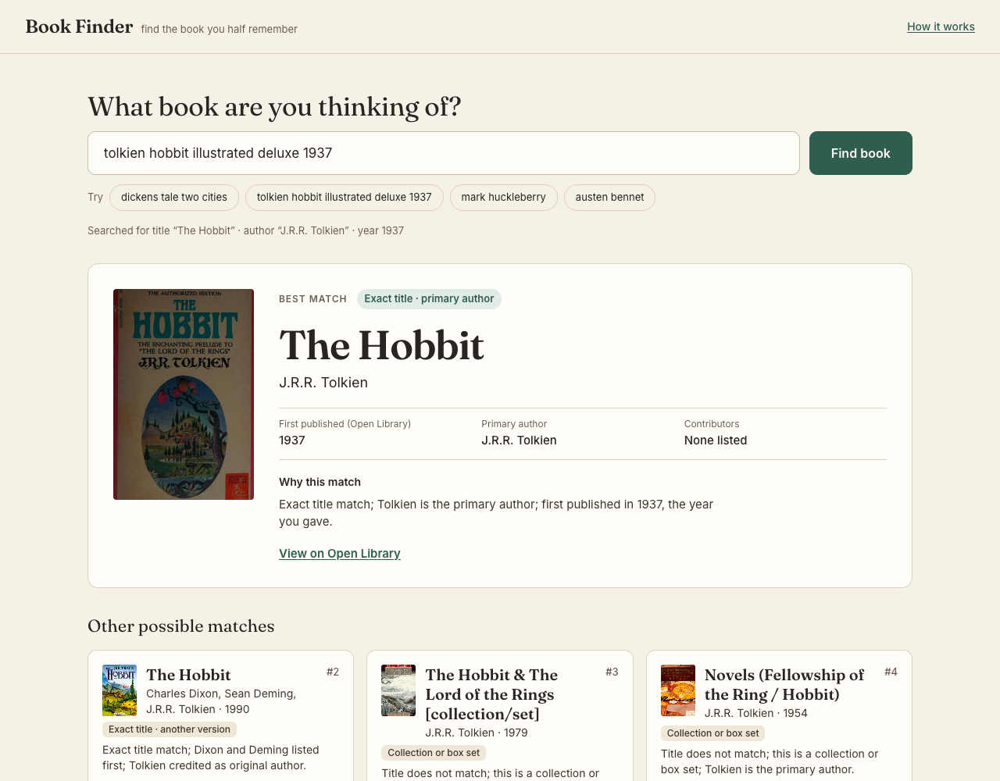
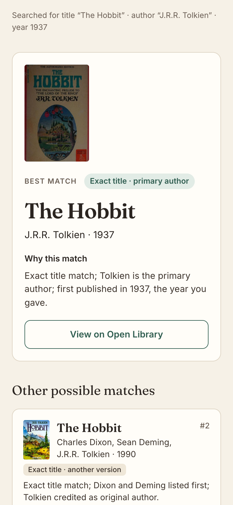

# Book Finder

[](https://github.com/beachsideproperty/infotrack-takehome/actions/workflows/ci.yml)

Paste a messy blob of whatever you remember about a book (a title, an author, a character, a year) and get back the book it most likely means, with a one-line reason grounded in Open Library data.

InfoTrack "Find That Book" take-home. React + TypeScript frontend, .NET 10 Web API, Gemini for parsing and explanations, Open Library for book data.

- **Live demo:** https://infotrack-takehome.vercel.app (web on Vercel)
- **API health:** https://infotrack-takehome.onrender.com/health (API on Render, free tier: the first request after idling can take ~50 s)

<p>
  
  
</p>

**Contents:** [Approach and priorities](#approach-and-priorities) · [Run locally](#run-locally) · [API](#api) · [Implementation overview](#implementation-overview) (matching hierarchy) · [Failures and unclear results](#failures-and-unclear-results) · [Assumptions and design decisions](#assumptions-and-design-decisions) · [Testing strategy](#testing-strategy) · [Future improvements](#future-improvements)

## Approach and priorities

The heart of the brief is deciding which book a messy query means, and saying why. I put most of the time there and into keeping it reliable, and kept everything else simple.

**Order of work**

1. **Deploy first.** A hello-world API and web page went live on Render and Vercel before any feature, so hosting, CORS and environment variables couldn't surprise me at the end.
2. **A deterministic core with tests.** Normalising, the A–E matching hierarchy and ranking are plain code, tested with golden queries over recorded Open Library data, before any LLM was involved.
3. **Gemini in a narrow role.** It reads the query and phrases the explanations; code decides everything else. A rule-based parser and template explanations sit behind it, so the app works without it.
4. **Hardening from production evidence.** Render logs showed the real failures were Google overloads and bursts against the free tier's per-minute limit, not bad answers. That led to our own rate cap, cooldowns, splitting the two calls across models, caching, specific failure reasons, and an eval that measures how well Gemini reads queries.
5. **The UI from the designs,** with every state built, not just the happy path: loading, ranked lists, author pages, no match, guesses, the fallback banner and each error.
6. **Making it easy to review:** this README, CI, and contract tests that keep the API and web app in step.

**Where I went deep**

- **Matching and data quality:** primary authors vs contributors from work records, detecting adaptations without role data, collapsing duplicate works, series, box sets, typos, accents, and name variants.
- **LLM integration and resilience:** schema-constrained output with code-side checks, measured model choice, staying inside the free tier, and a fallback that still finds most books.

**Deliberately left out:** chips to refine a search (the "Searched for …" line and an editable query cover most of the need); decades for unknown years (not in the data); real streaming progress (a timed loader over one request is honest enough at 3–6 s); a database or shared cache (one instance, in memory is enough); accounts and search history (out of scope).

## Why .NET 10 and not .NET 8

The brief asks for .NET 8. .NET 8 reached end of support on Nov 10, 2026, and .NET 10 is the current LTS, so this project targets .NET 10. The recruiter approved the change.

## Prerequisites

| Tool | Version | Needed for |
|---|---|---|
| Docker Desktop | any recent | `docker compose up` (simplest) |
| .NET SDK | 10.0 (pinned in `api/global.json`) | running the API without Docker, tests |
| Node.js | 22+ | running the web app without Docker |

## Gemini API key

1. Create a free key at https://aistudio.google.com/app/apikey.
2. Give it to the API one of these ways:
   - **Without Docker:** `cd api/src/BookFinder.Api && dotnet user-secrets set GEMINI_API_KEY "<your key>"`
   - **With Docker:** put `GEMINI_API_KEY=<your key>` in `.env` (copied from `.env.example`).
   - **Render:** add `GEMINI_API_KEY` under Environment.

No key? The API still runs: it falls back to a rule-based parser and template explanations, and responses say `"parser": "fallback"`. Optionally set `OPENLIBRARY_CONTACT_EMAIL` too, which identifies the app to Open Library and raises its rate limit from 1 to 3 requests per second.

## Run locally

### With Docker

```bash
cp .env.example .env          # then fill in GEMINI_API_KEY
docker compose up --build
```

- Web: http://localhost:5173
- API: http://localhost:8080/health

The header shows "Waking up the server…" until the API answers. Any search can be shared as a link: `http://localhost:5173/?q=austen%20bennet`.

### Without Docker

Terminal 1, the API (listens on http://localhost:8080):

```bash
cd api
dotnet run --project src/BookFinder.Api
```

Terminal 2, the web app (http://localhost:5173):

```bash
cd web
npm install
npm run dev
```

The web app calls `http://localhost:8080` by default. To point it elsewhere, create `web/.env.local` with `VITE_API_URL=...`.

Try a search:

```bash
curl -s localhost:8080/api/search -H 'Content-Type: application/json' -d '{"query":"tolkien hobbit illustrated deluxe 1937"}'
```

### Tests

```bash
cd api && dotnet test        # 197 tests, offline, ~1 s
cd web && npm test           # 43 tests (Vitest + Testing Library), API mocked
cd web && npm run build      # type-check + production build
```

After an intended change to the API's JSON, refresh the saved contract (then update `web/src/lib/types.ts` until `npm test` passes):

```bash
cd api && UPDATE_CONTRACTS=1 dotnet test --filter Category=Contract
```

CI (GitHub Actions, `.github/workflows/ci.yml`) runs the same checks on every push, plus lint and a Docker build of the API. It needs no secrets.

Refresh the recorded Open Library responses used by the golden tests (hits the live API, politely paced):

```bash
cd api && RECORD_FIXTURES=1 dotnet test --filter Category=Golden
```

## Configuration

| Variable | Where | Purpose |
|---|---|---|
| `GEMINI_API_KEY` | API | Gemini key. Locally: `dotnet user-secrets` or `.env` for Docker |
| `GEMINI_MODEL` | API | Optional. Parsing tries it first. Default `gemini-3.5-flash-lite` |
| `GEMINI_FALLBACK_MODEL` | API | Optional. Explanations try it first; each falls back to the other. Default `gemini-3.1-flash-lite` |
| `GEMINI_RPM_PER_MODEL` | API | Optional. Our own requests-per-minute cap per model, under Google's free-tier limit. Default 14 |
| `OPENLIBRARY_CONTACT_EMAIL` | API | Contact in the Open Library User-Agent (3 req/s instead of 1) |
| `SEARCH_RATE_LIMIT_PER_MINUTE` | API | Optional. Searches per client IP per minute before a 429. Default 10 |
| `ALLOWED_ORIGINS` | API | Comma-separated origins allowed by CORS, no trailing slash |
| `PORT` | API | Port to bind on `0.0.0.0`. Render sets it (default 10000) |
| `APP_VERSION` | API | Optional. Overrides the version `/health` reports (default: the assembly version) |
| `RENDER_GIT_COMMIT` | API | Set by Render; `/health` shows its first 7 characters as `commit` |
| `VITE_API_URL` | Web | API base URL. Baked in at build time, so never put secrets here |

See `.env.example`.

## Project layout

```
api/                         .NET 10 solution (BookFinder.sln) + Dockerfile
  src/BookFinder.Api             Endpoints, request validation, ProblemDetails, CORS, DI
  src/BookFinder.Application     SearchService, matching hierarchy, ranker, fallback parser, templates (pure code)
  src/BookFinder.Domain          Records: hypotheses, candidates, tiers, outcomes
  src/BookFinder.Infrastructure  Open Library client (rate limit, cache, retry), Gemini client (model fallback)
  tests/BookFinder.Tests         Unit, golden-query, client, API and contract tests + recorded Open Library JSON
  tools/BookFinder.LlmEval       Measures Gemini's reading of the golden queries (run by hand; calls Gemini)
web/                         Vite + React + TypeScript + Tailwind v4 (+ Motion, Vitest)
  src/lib                      API client and types, search state, labels, validation
  src/components               One component per screen element from the designs
contracts/                   Real API responses saved by the API tests and checked against the web app's types
docker-compose.yml
```

## API

| Method | Path | Response |
|---|---|---|
| GET | `/health` | `200 { "status": "ok", "version": "0.1.0", "commit": "abc1234", "ai": { … } }` (`commit` only on Render; `ai` below) |
| POST | `/api/search` | `200` search outcome (below); `400` bad input; `429` too many searches from this client; `502` Open Library down; `503` Open Library rate-limiting |

```jsonc
// POST /api/search  { "query": "tolkien hobbit illustrated deluxe 1937" }
{
  "query": "tolkien hobbit illustrated deluxe 1937",
  "interpretedAs": [{ "title": "The Hobbit", "author": "J.R.R. Tolkien", "keywords": ["illustrated", "deluxe"], "year": 1937, "isSeries": false }],
  "mode": "match",                 // "match" | "authorOnly" | "noMatch"
  "hasBestMatch": true,            // show a hero card only when true
  "parser": "llm",                 // "llm" | "fallback"
  "explanations": "llm",           // "llm" | "template"
  "results": [
    {
      "title": "The Hobbit",
      "authors": ["J.R.R. Tolkien"],          // primary authors, from the work record
      "contributors": [],                      // other names Open Library attaches to the work
      "firstPublishYear": 1937,
      "openLibraryId": "OL27482W",
      "url": "https://openlibrary.org/works/OL27482W",
      "coverUrl": "https://covers.openlibrary.org/b/id/14627509-L.jpg",
      "matchTier": "A",
      "explanation": "Exact title match; Tolkien is the primary author on the work record; first published in 1937, the year you gave."
    },
    {                                          // abbreviated
      "title": "The Hobbit",
      "authors": ["Charles Dixon", "Sean Deming", "J.R.R. Tolkien"],
      "matchTier": "B",
      "explanation": "Exact title, but Charles Dixon is listed first on this version; J.R.R. Tolkien is credited after them, so it ranks below the original."
    }
  ]
}
```

- `/health` → `ai` is Gemini as the server currently sees it, built from recent calls and never by calling Google, so it costs nothing to check: `{ "status": "ok" | "limited" | "unavailable" | "notConfigured", "models": [{ "model", "available", "issue"?, "retryInSeconds"?, "requestsLastMinute" }] }`. `limited` means one model is resting and the other still works. `/health` stays 200 either way, so Render never restarts the API because Google is busy. The web app shows "Basic matching" in the header when every model is resting.
- Each result also has `match: { title: "exact"|"near"|"none", author: "primary"|"contributor"|"none", yearMatched, seriesMember, collection, derivative, keywordOnly }`, so the UI can label it precisely.
- `aiIssue` appears only when Gemini wasn't used, for the parse or else the explanations: `"overloaded"` (Google's 503 "high demand"), `"timedOut"`, `"rateLimited"` (per-minute, Google's or our own cap), `"dailyQuota"` (free tier used up until midnight Pacific), `"notConfigured"` or `"error"`. When the two models failed differently it reports the one that clears soonest, since that's when trying again helps.
- `noMatch` can still carry results: "closest guesses" from a keyword search, when the query described a book without naming a title or author.
- Fields with no value are left out (a missing `firstPublishYear` is never `0`). `didYouMean: { title, author }` appears only on `noMatch`; `author: { name, openLibraryId, url }` only on `authorOnly`, for the "all works by …" link.
- `firstPublishYear` is exactly what Open Library reports, which is sometimes wrong (see design decisions).
- The brief's sample uses `author` (string) and `first_publish_year`; this API returns `authors[]` (a work can have several) and camelCase, the .NET and TypeScript convention.
- Errors are RFC 7807 ProblemDetails. Validation errors carry the message to show under the input in `detail` and `errors.query`:
  - empty: "Type a title, an author or a few words you remember."
  - over 300 characters: "That's a lot to go on. Try the few words you're surest about."

## Deployment

- **API on Render:** Web Service, Docker runtime, root directory `api`, health check `/health`. Env vars: `GEMINI_API_KEY`, `OPENLIBRARY_CONTACT_EMAIL`, `ALLOWED_ORIGINS`.
- **Web on Vercel:** root directory `web`, Vite preset, env `VITE_API_URL=https://<service>.onrender.com`.
- Render's free tier sleeps when idle. The first request can take ~50 s, which the "Waking up the server…" pill covers.

## Implementation overview

**The LLM reads and explains; code decides.** Gemini turns the messy text into hypotheses and writes the one-line reasons. Plain, deterministic code searches Open Library, applies the matching hierarchy and ranks, so ranking is unit-tested and still works when Gemini is down.

```
query ─▶ validate (1–300 chars)
      ─▶ Gemini: 0–3 hypotheses { title?, author?, keywords[], year?, isSeries }   ── fails? ─▶ rule-based parser
      ─▶ no title or author in any hypothesis?  ─▶ noMatch ("pizza recipe"), no Open Library calls
      ─▶ author only?  ─▶ resolve author key ─▶ search.json?author_key=…&sort=readinglog ─▶ tier D
      ─▶ otherwise: search.json per hypothesis (parallel) ─▶ dedupe ─▶ provisional rank
                    ─▶ works/{id}.json for the top 5 (primary authors) ─▶ classify A–E ─▶ rank
      ─▶ Gemini: one batched call writes all explanations                          ── fails? ─▶ templates
```

**Matching hierarchy** (`TierClassifier`, `Ranker`):

| Tier | Meaning |
|---|---|
| A | Exact title (after normalizing) and a primary author from the work record |
| B | Exact title, but the author is only a contributor |
| C | Near title (typos, reordering, series member) and the author matches |
| D | Author-only query: that author's most-read works |
| E | Weaker: only the title or only the author matches; box sets and omnibuses |

Within a tier: the year named in the query → the matched author's place on the work record → exact over near title → likelier hypothesis → Open Library reading-log count → edition count → work key. The same input always produces the same order (tested by shuffling).

**Normalizing:** Unicode NFKD, accents and punctuation stripped, lowercase, leading article dropped. Title variants split on `:`, `;`, `, or`, ` (`, ` - `, so "The Hobbit, or There and Back Again" matches "the hobbit". Author names match on surname plus compatible given names or initials ("J.R.R. Tolkien" = "John Ronald Reuel Tolkien"; "Charles Dickens" ≠ "Monica Dickens").

**Without Gemini** the rule-based parser strips noise and sends the rest to Open Library as free text, and the classifier works out which words were the author: a surname in the text, or a first name when the other words match that book's title ("mark huckleberry" → Mark Twain). There, any title containing every typed word counts as near, because the reader only typed fragments and the candidates already come from Open Library's relevance search.

**Open Library budget:** one `search.json` per hypothesis (max 3), `works/{id}.json` for the top 5 only, `authors/{id}.json` only when a name is missing. A process-wide token bucket keeps us at 3 requests/second with an identified User-Agent (1/s without), responses are cached by URL, each call times out at 6 s and is retried once. A new query costs about 6–8 Open Library calls and two Gemini calls, typically 3–6 s.

**Caching:** results are cached by normalized query ("Tolkien Hobbit!" = "tolkien hobbit") for 6 hours, so a repeated search, like the example chips, never spends Gemini quota. A result that needed the rule-based parser or template explanations is kept for only 2 minutes, and Gemini's reading of the query is cached separately, so a better result replaces it once Gemini recovers. Everything is in memory, so a Render restart (the free tier sleeps when idle) starts cold.

**Web app:** one page, one request per search. A `useReducer` state machine (`idle → loading → done | error`) drives the screens from `design/`. A new search aborts the one in flight, so a slow answer can never overwrite a newer one. The three loading steps (Read your words → Searching Open Library → Ranking matches) are paced by a client-side timer over that single request, with skeletons shaped like the real cards. Input is checked with the same rules and wording as the API before sending. Labels come from the API's `match` details, never guessed from the tier letter. Motion adds gentle fade-ins and is switched off for people who ask their OS for reduced motion.

## Failures and unclear results

Every case has a defined behaviour, and the query is never lost:

| Situation | What the API does | What the reader sees |
|---|---|---|
| Empty or over 300 characters | 400 ProblemDetails | Inline message under the search box (also checked before sending) |
| Clear winner | `hasBestMatch: true` | Best-match card + other possible matches |
| Several plausible books | `hasBestMatch: false` | Ranked list, "No single result clearly beats the rest" |
| Series ("harry potter") | `isSeries`, series members as near matches | "Books in the Harry Potter series", no winner |
| Author only ("dickens") | `authorOnly`, most-read works | "Top works by Charles Dickens" + link to all their works |
| A book described but not named ("a whale and a lighthouse") | `noMatch` + keyword "closest guesses" | "No confident match yet" + guesses labelled "Keyword only" |
| Not a book ("pizza recipe") | `noMatch`, no Open Library calls | "No confident match yet", honest empty state |
| Gemini down, slow or rate-limited | Rule-based parser and/or template reasons; `aiIssue` says why, and the log line names each model's failure | Banner that says why ("Google's AI is busy right now… Try again in a minute", "Today's free AI quota is used up…"); note when reasons are templates |
| Basic matching's known limits (only while Gemini is down) | "1984 by orwell" reads 1984 as a year → Orwell's works; "tale two cities" puts an obscure book literally titled *A tale two cities* first, Dickens second; "pizza recipe" shows pizza books (never as a best match); a described book ("a whale and a lighthouse") finds nothing | The banner explains results come from basic matching; everything is still a real Open Library record |
| Open Library down or slow | One retry, then 502 | "Can't reach Open Library right now" + Try again (query kept) |
| Open Library rate-limiting us | 503 + `Retry-After` | "Open Library is busy" + countdown |
| Too many searches from one visitor | 429 + `Retry-After` | "Lots of searches at once" + countdown |
| API asleep (Render free tier) | — | "Waking up the server…" in the header; a 60 s request timeout, then "Can't reach the search server" + Try again |
| No cover | — | Coloured block with the title |
| Wrong year in Open Library | Reported as is | Labelled "First published (Open Library)" |

## Assumptions and design decisions

- **Accuracy over speed.** Each top candidate's work record is fetched to separate primary authors from contributors, as the brief requires. That costs a couple of seconds under Open Library's rate limit; caching and the staged loading state cover it. With more time: stream partial results.
- **Primary authors and adaptations.** Open Library's `works.authors` has no roles: Charles Dixon's graphic-novel *Hobbit* lists Dixon, Deming and Tolkien as equal authors. Rule: everyone on the work record is a primary author, and names only in search results are contributors. Then, when another work with the same title lists the queried author *first*, versions that list them later are treated as someone else's adaptation: the author counts as a contributor there (tier B). That reproduces the brief's example ("Tolkien is primary author; Dixon listed as adaptor") without guessing roles, and leaves genuine co-authors (*Good Omens*) at tier A.
- **Duplicate work records.** Open Library often has several works for one book (five *Adventures of Huckleberry Finn* by Mark Twain, "… - Ukrainian Edition"). Works with the same base title and lead author collapse to the strongest, most-read one.
- **Series and box sets.** Gemini flags series queries ("harry potter"): the books in the series are listed with no best match, and the explanations say why. Box sets, omnibuses and multi-title volumes are capped at tier E because the brief asks for works.
- **Best-match card is earned.** `hasBestMatch` is true only when the top result is tier A–C and beats the runner-up on match strength, or is equally strong but read 5× more. Never for series, author-only or weak matches.
- **Author-only popularity.** `search.json?author_key=…&sort=readinglog` (most reading-log entries first) replaces `/authors/{id}/works.json`, which can't sort by popularity. The author key comes from the full name Gemini supplies ("dickens" alone ranks Monica Dickens first in Open Library's author search).
- **Years.** A year breaks ties and is cited in the explanation. Code keeps a year only if it appears in the query and isn't part of the title, in digits or spelled out ("1984 by orwell" → *Nineteen Eighty-Four*, no year), so the model can't invent one. The spelled-out case was found by the Gemini eval: both models return 1984 as a year there despite the prompt. Edition words ("illustrated", "deluxe") are ignored, since results are works, not editions.
- **Never an LLM-only guess.** Every result comes from Open Library. Gemini only proposes what to search for and phrases the explanation; its output is schema-constrained, trimmed and capped, and the explanation prompt only sees fields we fetched plus how code classified the match. The year is sent to it only when it matched.
- **Prompt injection.** The query is passed as a JSON string labelled as data, the system prompt says to ignore instructions inside it, and the response must match a JSON schema. The worst a malicious query can do is produce odd hypotheses, which then have to match real Open Library records.
- **Gemini model choice.** Measured on Nov 24, 2026 on the free tier: `gemini-3.8-flash` timed out, returned 503 or was rate-limited on nearly every call (and allows only 5 requests/minute), while `gemini-3.5-flash-lite` answered in about 1 s and read every golden query correctly. Both models are configurable.
- **Staying inside the free tier.** Flash-Lite allows 15 requests per minute per model, and each search makes two calls. Production logs showed the failures were Google-side (503 "high demand" and slow answers), while 429s came only from bursts of testing. So:
  - *Split the load.* Parsing tries `gemini-3.5-flash-lite` first and explanations try `gemini-3.1-flash-lite` first, each falling back to the other. Each model has its own quota, which roughly doubles the headroom.
  - *Never cause a 429.* A process-wide gate caps each model at 14 requests/minute. At the cap we go straight to the other model or the deterministic fallback without calling Google.
  - *Cool down instead of waiting.* After a 429 the model is skipped for Google's `retryDelay` (until midnight Pacific for a daily quota); after a 503, for 20 s; after a timeout, for 10 s. Skipping costs no time, so a degraded search takes about 3 s instead of 20.
  - *Time budgets from measured latency.* Successful answers took 0.6–5.2 s. Parsing gets 9 s in total, of which the first model gets 5.5 s; explanations get 6 s, of which the first model gets 4 s. If parsing had to fall back, the explanation call is skipped.
  - *Readable failures.* Every attempt logs the operation, model, latency and Google's status, message, quota id and retry delay (never the key or the prompt). Each failure is classified (overloaded, timed out, rate limited, daily quota), so the response's `aiIssue`, the banner and `/health` can say whether trying again will help.
- **Publication years are Open Library's.** `first_publish_year` is noisy (*A Tale of Two Cities* shows 1800; it was 1859), and the work records are worse. We report Open Library's value as is and label it as theirs in the UI, rather than "correcting" it with the LLM, which would break the rule that every fact comes from Open Library.
- **Per-client rate limit.** Each client IP gets 10 searches a minute (configurable); beyond that the API returns a 429 ProblemDetails, "Lots of searches at once", with `Retry-After`. It keeps one visitor from spending the shared Gemini and Open Library quotas. The client IP comes from `X-Forwarded-For`, since Render sits behind a proxy.
- **No database.** Open Library responses are cached in memory per instance (6 hours).

## Features

- Search UI built from the designs: first visit with example chips and how it works, staged loading, best match, ranked lists, author page, no-match with guesses and "Did you mean", AI-unavailable banner that says why, a header note when every AI model is resting, error cards; desktop and mobile; keyboard (`/` focuses the search box, Enter searches) and screen-reader announcements; shareable `?q=` links.
- One input for any mix of title, author, character, year and noise, with typo and diacritics tolerance.
- Gemini hypotheses (up to 3), including titles from character hints ("austen bennet" → *Pride and Prejudice*) and published title forms ("1984" → *Nineteen Eighty-Four*).
- The brief's A–E matching hierarchy with primary-author resolution from work records, adaptation detection, duplicate-work collapsing, series and box-set handling.
- Author-only queries return the author's most-read works.
- A grounded one-sentence explanation per result (Gemini, or deterministic templates).
- Graceful degradation: Gemini down → rule-based parser + templates, with the reason shown; Open Library slow → one retry, then a clear 502.

## Testing strategy

`cd api && dotnet test` runs 197 tests offline in about a second; `cd web && npm test` runs 43 web tests with the API mocked. No test calls Gemini or the network.

| Layer | What's covered |
|---|---|
| Unit | Normalizer, title variants and near matches, author name matching, every tier A–E, adaptation demotion, collections, series, ranker order and determinism, best-match rule, fallback parser and its free-text matching (partial titles, first names), years the title spells out, template sentences |
| Web (Vitest + Testing Library) | Every result mode (best match, ranked list, series, author only, keyword guesses), "Did you mean" re-search, inline validation without calling the API, server 400 inline, 429 countdown, 502 card with Try again re-running the same query, AI-unavailable banner, example chips, `/` shortcut, `?q=` links, a slow older answer never overwriting a newer one, label and "Searched for" wording, the loading-step timer, the banner naming why the AI was unavailable, the header note only when every model is resting |
| Caching | Same query twice (differently typed) → one Gemini call each for parse and explanations; degraded results expire after 2 minutes but Gemini's reading is reused; explanations skipped after a parse fallback |
| Golden queries | The 11 queries from the spec, end to end through the real `SearchService` and `OpenLibraryClient`, replaying recorded Open Library JSON (`tests/.../Fixtures/openlibrary`). Gemini is replaced by the hypotheses it actually returned, so the tests pin down what code decides given a reading. Every query also runs with Gemini "down" (rule-based parser): it still finds Hobbit, Huckleberry Finn, Twilight, Les Misérables, Pride and Prejudice ("austen bennet", via Open Library's full-text search), Dickens' works and the Harry Potter books. The known limits are pinned by tests too (see "Failures and unclear results") |
| Clients | Gemini: key in a header (never the URL), fallback model on 503/429/404, a hanging model leaves time for the fallback, explanations start on the other model, `/health` status from the gate (ok, limited, unavailable, our own cap), cooldowns (503 → 20 s, 429 → Google's retry delay, daily quota → midnight Pacific, with a fake clock), the per-minute cap routing to the other model, the failure reason reported (and kept while a model is skipped on cooldown), Google error-body parsing, junk JSON → unavailable. Open Library: parsing, work-record authors, 404 → null, caching by URL, retry once, timeout and 429 handling, URL escaping |
| Contract | The API tests save a real response for each kind of result (best match, author only, series, keyword guesses, not a book, fallback), a validation error and `/health` to `contracts/*.json`, and fail if the output changes. A web test checks the same files against the TypeScript types: an unknown field, a missing required field or an unknown enum value fails. The checks are typed against the interfaces, so TypeScript makes them list every field. The two sides can't drift apart unnoticed |
| API | `WebApplicationFactory` with fakes: response contract, `/health` AI status (no secrets), author link on author-only results, 400 messages (empty, whitespace, 301 chars; 300 is fine), malformed JSON, 429 per-client limit with `Retry-After`, 502 and 503 ProblemDetails, fallback flags, CORS preflight |

### Evaluating Gemini's reading

The tests fake Gemini, so they pin what *code* decides. How well Gemini *reads* queries is measured separately by `api/tools/BookFinder.LlmEval`: each golden query, plus a not-a-book query and a prompt injection, goes through the production prompt, schema and sanitizing on each model, and is scored against what the reader meant. It calls Gemini (~26 calls, paced for the free tier), so it's run by hand, not in CI:

```bash
GEMINI_API_KEY=... dotnet run --project api/tools/BookFinder.LlmEval   # writes api/tools/BookFinder.LlmEval/RESULTS.md
```

Results from Nov 25, 2026 ([full table](api/tools/BookFinder.LlmEval/RESULTS.md)):

| Model | Right (of answered) | Answered first try | Median |
|---|---|---|---|
| `gemini-3.5-flash-lite` (parsing tries it first) | 12/13 | 10/13 | 0.8 s |
| `gemini-3.1-flash-lite` | 7/10 | 6/13 (3 never answered) | 1.5 s |

What it changed:
- **Found a bug:** both models return 1984 as a year alongside the title *Nineteen Eighty-Four*. The sanitizer now drops a year the title spells out (the one ❌ in the 3.5 column predates the fix).
- **Confirmed the model order:** 3.5 is more accurate and faster. 3.1 obeyed the prompt injection (a hypothesis titled "Hacked") and guessed *Moby-Dick* for the vague whale query instead of returning keywords. Both are contained by design: every result must be a real Open Library record, and 3.1 is only the fallback for parsing.
- **Availability is the real risk, not accuracy:** a quarter to half of the calls needed a retry because Google was overloaded, which is why the fallback path, cooldowns and `aiIssue` matter.

## Future improvements

In rough priority order:

1. **Real progress and partial results.** Stream stages over server-sent events and show the search-row results while work records load, instead of a timed loader.
2. **A third LLM option.** Overload, not accuracy, is the main failure. A paid tier or a second provider behind the same `ILlmQueryParser` port would make the fallback rare.
3. **A persistent, shared cache** (Redis) so restarts and extra instances don't start cold, warmed with popular queries.
4. **A bigger eval, run on a schedule.** More vague, multilingual and adversarial queries; track accuracy and latency over time; compare prompt changes before shipping them.
5. **Smarter basic matching** for when Gemini is down: tell "1984" the title from 1984 the year, and prefer well-read works over obscure literal title matches.
6. **Editions.** Results are works, as the brief asks. "illustrated deluxe" could also suggest matching editions.
7. **Refining a search:** "Did you mean" for keyword guesses, and chips to add an author or year.
8. **End-to-end browser tests** (Playwright against `docker compose`) in CI.
9. **Observability:** structured logs to a dashboard, and alerts on fallback rate and latency.
10. **No cold starts:** a paid Render instance or a host that doesn't sleep.
